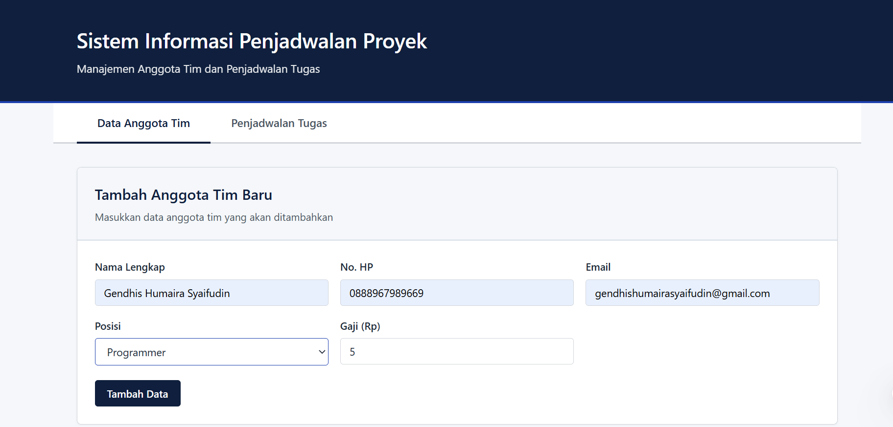
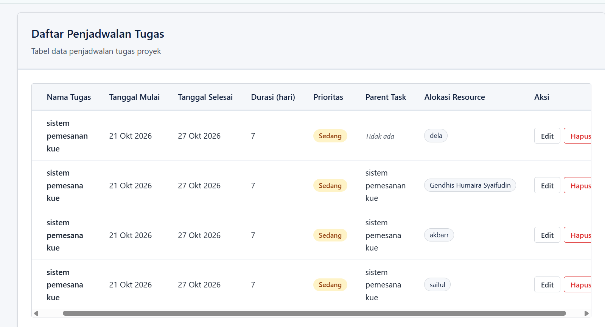

# Sistem Informasi Penjadwalan Proyek

## Penjelasan Singkat Fitur Aplikasi

Aplikasi web ini merupakan Sistem Informasi Penjadwalan Proyek yang dirancang untuk membantu pengelolaan anggota tim dan penjadwalan tugas proyek secara menyeluruh, mulai dari perencanaan, visualisasi jadwal, hingga analisis jalur kritis proyek.

Fitur utama yang tersedia:

- **CRUD Data Anggota Tim** - Pengelolaan data anggota tim meliputi Nama, No HP, Email, Posisi (PM, Analis, Programmer, Tester), dan Gaji.
- **CRUD Data Penjadwalan Tugas** - Pengelolaan data tugas yang detail: Nama Tugas, Tanggal Mulai, Tanggal Selesai (otomatis), Durasi (hari), Prioritas (Rendah/Sedang/Tinggi), Parent Task (dependensi antar tugas), dan Alokasi Resource (anggota tim).
- **Bagan Gantt** - Visualisasi jadwal tugas secara kronologis berdasarkan durasi dan dependensi, dengan warna batang sesuai tingkat prioritas.
- **Analisis Jalur Kritis (CPM)** - Perhitungan Critical Path Method: ES, EF, LS, LF, dan Slack setiap tugas, durasi total proyek, serta penandaan tugas kritis.
- **Export / Import Data** - Ekspor seluruh data proyek (anggota tim dan tugas) ke berkas JSON, serta impor kembali untuk memuat ulang data.

Aplikasi dibangun dengan tampilan yang minimalis, rapi, dan berstandar akademis menggunakan palet warna profesional (navy blue, putih, dan abu-abu terang).

## Panduan Cara Menjalankan Aplikasi

### Prasyarat
- Node.js dan npm telah terinstal di komputer Anda

### Langkah-langkah

1. Install dependencies
```bash
npm install
```

2. Jalankan development server
```bash
npm run dev
```

3. Buka aplikasi di browser melalui link localhost yang ditampilkan pada terminal (contoh: `http://localhost:5174/`)

## Dokumentasi UI

### UI Anggota Tim


### UI Penjadwalan Tugas

